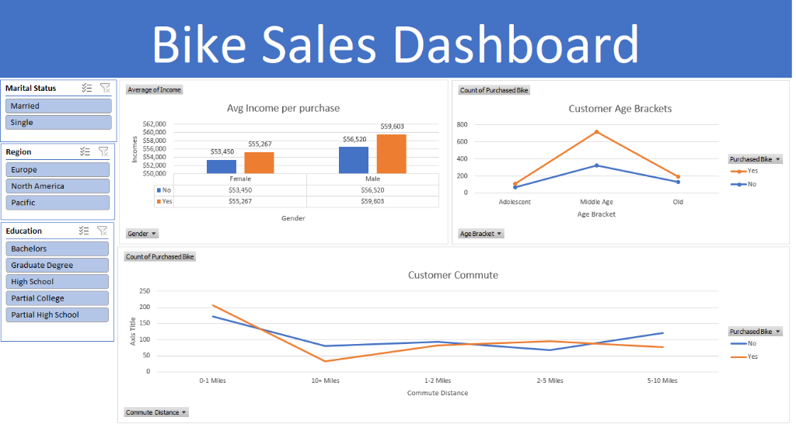

# 🚲 Bike Sales Analysis & Interactive Excel Dashboard

An end-to-end data analytics project built in Microsoft Excel that transforms raw customer demographic and purchase data into an interactive executive dashboard. This project addresses critical business questions around customer segmentation, purchasing power, demographic patterns, and mobility behavior to optimize sales and marketing strategies.

---

## 📌 Table of Contents
- [Executive Summary](#executive-summary)
- [Business Problem Solved](#business-problem-solved)
- [Operational & Data Problems Solved](#operational--data-problems-solved)
- [Dataset Architecture](#dataset-architecture)
- [Data Cleaning & Preparation](#data-cleaning--preparation)
- [Pivot Tables & Analysis](#pivot-tables--analysis)
- [Interactive Dashboard Features](#interactive-dashboard-features)
- [Key Business Insights](#key-business-insights)
- [Actionable Strategic Recommendations](#actionable-strategic-recommendations)
- [How to Explore This Project](#how-to-explore-this-project)
- [Dashboard Preview](#️-dashboard-preview)

---

## 📊 Executive Summary
The goal of this project is to analyze customer demographic, economic, and commute patterns to determine the primary drivers behind bicycle purchase decisions (`Purchased Bike: Yes / No`). 

By building an interactive Excel dashboard with synchronized slicers and dynamic pivot charts, leadership and marketing teams can instantly drill down into customer personas across geographies (**Europe**, **North America**, **Pacific**), educational backgrounds, and marital statuses.

---

## 🎯 Business Problem Solved

### 1. Lack of Targeted Customer Profiling
* **Before:** Marketing and sales teams operated with a generic mass-marketing approach, spending acquisition budgets equally across all customer segments without knowing who the actual high-intent buyers were.
* **Solution:** The dashboard isolates specific demographic segments (e.g., **Middle-aged professionals aged 31–54 with higher disposable income**) as the highest-converting customer profile, enabling hyper-targeted marketing campaigns.

### 2. Inefficient Commute & Product Positioning
* **Before:** Management did not have visibility into how customer daily travel distance influences bike adoption.
* **Solution:** The analysis proves that customers commuting **0–1 miles** and **2–5 miles** have the highest bike adoption rates. Customers with commutes over **10+ miles** show a steep drop in bike purchases. This allows the business to position standard commuting bikes for short-distance travelers while pitching electric bikes (e-bikes) or alternative solutions for longer distances.

### 3. Income & Pricing Alignment
* **Before:** Pricing and financing packages were not aligned with customer purchasing power across genders.
* **Solution:** The dashboard highlights that bike purchasers have a consistently higher average income ($55k+ for females, $59k+ for males) compared to non-purchasers ($53k and $56k). This insight helps sales design tailored financing plans or bundle premium gear for higher-income brackets while creating accessible entry-level options for lower-income groups.

### 4. Regional & Educational Sales Disparities
* **Before:** Regional managers struggled to explain varying sales volumes across regions and educational qualifications.
* **Solution:** Interactive slicers allow regional heads to filter by **Region (North America, Europe, Pacific)** and **Education (Bachelors, Graduate Degree, High School, Partial College, Partial High School)** to adapt local marketing channels and promotional messaging.

---

## 🛠️ Operational & Data Problems Solved

| Problem in Raw Data | Impact on Analysis | Excel Solution Implemented |
|---|---|---|
| **Abbreviated Categorical Codes** | Raw data contained single letters like `M` and `S` for Marital Status, and `M` and `F` for Gender, causing ambiguity between Marital Status (`M`) and Male (`M`). | Used **Find & Replace** in a dedicated `Working sheet` to standardize values into `Married`, `Single`, `Male`, and `Female`. |
| **Unbinned Continuous Age Variable** | Raw age ranged continuously from 25 to 89, making standard charts noisy, overcrowded, and impossible to derive clear demographic trends. | Created an engineered feature **`Age Bracket`** using nested Excel `IF` logic: `<31: Adolescent`, `31–54: Middle Age`, `>54: Old`. |
| **Unformatted Numeric Values** | `Income` values were stored as plain unformatted integers (e.g., `40000`), making executive review difficult. | Applied **Currency Formatting** (`$#,##0`) to all income metrics without decimal clutter. |
| **Data Preservation Risk** | Directly editing raw source records risks unrecoverable data loss during transformations. | Structured the workbook into clear architectural layers: `bike_buyers` (Raw Source), `Working sheet` (Cleaned & Processed), `Pivot` (Aggregated Tables), and `Dashboard` (Presentation). |

---

## 📁 Dataset Architecture

The workbook contains **1,026 customer records** across 13 core attributes:

| Column Name | Data Type | Description |
|---|---|---|
| **ID** | Integer | Unique identifier for each customer |
| **Marital Status** | Categorical | `Married`, `Single` |
| **Gender** | Categorical | `Male`, `Female` |
| **Income** | Numeric (Currency) | Annual income of customer (in USD) |
| **Children** | Integer | Number of children |
| **Education** | Categorical | `Bachelors`, `Graduate Degree`, `High School`, `Partial College`, `Partial High School` |
| **Occupation** | Categorical | `Clerical`, `Management`, `Manual`, `Professional`, `Skilled Manual` |
| **Home Owner** | Boolean | `Yes`, `No` |
| **Cars** | Integer | Number of automobiles owned |
| **Commute Distance** | Categorical | `0-1 Miles`, `1-2 Miles`, `2-5 Miles`, `5-10 Miles`, `10+ Miles` |
| **Region** | Categorical | `Europe`, `North America`, `Pacific` |
| **Age** | Integer | Customer's chronological age |
| **Age Bracket** *(Derived)* | Categorical | `Adolescent` (<31), `Middle Age` (31–54), `Old` (>54) |
| **Purchased Bike** *(Target)* | Categorical | `Yes` (Purchased), `No` (Did not purchase) |

---

## 🔄 Data Cleaning & Preparation

1. **Raw Data Isolation:** Kept `bike_buyers` completely untouched as the raw immutable backup.
2. **Standardization in `Working sheet`:**
   - Replaced `M` with `Married` and `S` with `Single` in the *Marital Status* column.
   - Replaced `M` with `Male` and `F` with `Female` in the *Gender* column.
3. **Feature Engineering (Age Brackets):**
   - Implemented a nested conditional formula in Column M:
     ```excel
     =IF(L2>54, "Old", IF(L2>=31, "Middle Age", IF(L2<31, "Adolescent", "Invalid")))
     ```
4. **Number Formatting:** Formatted the `Income` column as standard currency (`$`).

---

## 📈 Pivot Tables & Visualizations Breakdown

The presentation layer (`Dashboard`) is powered by three dedicated Pivot Tables located in the `Pivot` sheet:

### 1. Avg Income per Purchase (`Clustered Column Chart`)
* **Objective:** Understand how disposable income and gender correlate with purchase decisions.
* **Findings:**
  - **Female:** Non-buyers average **$53,450**, while buyers average **$55,267** (~$1.8k higher).
  - **Male:** Non-buyers average **$56,520**, while buyers average **$59,603** (~$3.1k higher).
* **Takeaway:** Customers with higher average income are consistently more likely to buy bikes. Men earn and spend slightly higher than women in this dataset.

### 2. Customer Age Brackets (`Line Chart with Markers`)
* **Objective:** Identify the core demographic lifecycle stage driving bicycle purchases.
* **Findings:**
  - **Adolescent (<31 yrs):** 41 Bought vs 71 Did not buy (Total: 112)
  - **Middle Age (31–54 yrs):** **393 Bought** vs 326 Did not buy (Total: 719) — *Peak adoption segment!*
  - **Old (>54 yrs):** 61 Bought vs 134 Did not buy (Total: 195)
* **Takeaway:** Middle-aged customers represent **79.4% of all bike purchases**. Adolescents and seniors have significantly lower conversion rates.

### 3. Customer Commute Distance (`Line Chart with Markers`)
* **Objective:** Analyze daily commuting habits as a catalyst for purchasing bicycles.
* **Findings:**
  - **0–1 Miles:** 207 Buyers vs 171 Non-buyers (Highest purchase volume).
  - **1–2 Miles:** 83 Buyers vs 93 Non-buyers.
  - **2–5 Miles:** 95 Buyers vs 67 Non-buyers (Strong positive conversion).
  - **5–10 Miles:** 77 Buyers vs 120 Non-buyers.
  - **10+ Miles:** 33 Buyers vs 80 Non-buyers (Drastic drop-off).
* **Takeaway:** Short commutes (0–1 miles and 2–5 miles) represent the primary functional utility for bicycles. Beyond 5 miles, physical fatigue and time constraints cause purchase intent to decline.

---

## 🎛️ Interactive Dashboard Slicers

The dashboard includes 3 interactive Excel Slicers connected via **Report Connections** to all pivot charts:

1. **Marital Status:** Filter between `Married` and `Single`.
2. **Region:** Segment across `Europe`, `North America`, and `Pacific`.
3. **Education:** Filter by `Bachelors`, `Graduate Degree`, `High School`, `Partial College`, and `Partial High School`.

*Selecting any combination dynamically updates all three charts simultaneously, allowing real-time multi-dimensional analysis.*

---

## 💡 Key Business Insights

1. **The Ideal Customer Persona:**
   - **Age:** 31 to 54 years old (Middle Age).
   - **Income:** Greater than $55,000 annually.
   - **Commute:** Living within 0 to 5 miles from their workplace.
   - **Education:** Bachelors or Graduate Degree holders show higher purchasing power and health consciousness.

2. **Commute Distance Threshold:**
   - 0–1 mile commuters have the highest conversion rate.
   - For commutes over 10 miles, customers avoid traditional bicycles, signaling a potential market for motorized/e-bike products.

3. **Demographic Gap in Younger & Senior Audiences:**
   - Adolescents (<31) are likely held back by lower entry-level income.
   - Seniors (>54) likely face physical ergonomics or health limitations on standard pedal bikes.

---

## 🚀 Actionable Strategic Recommendations

1. **Targeted Digital Ad Campaigns:**
   - Allocate 75%+ of marketing budget to the 30–50 age demographic on platforms like LinkedIn, Instagram, and Facebook.
   - Emphasize work-life balance, eco-friendly commuting, and cardiovascular fitness.

2. **Proximity-Based Marketing (0–5 Miles):**
   - Partner with corporate offices, tech parks, and university campuses within a 5-mile radius of retail stores for corporate purchase discounts or bike-to-work schemes.

3. **Introduce Financing / EMI Options for Younger Demographics:**
   - Offer zero-interest installment plans (Buy Now Pay Later) to reduce the upfront cost barrier for younger adults earning under $45,000.

4. **Product Line Diversification (E-Bikes for 10+ Mile Commuters):**
   - Introduce electric commuter bicycles to capture the 10+ mile commuter segment that currently rejects standard bicycles due to distance.

5. **Comfort & Step-Through Bikes for Seniors:**
   - Market ergonomic, lightweight, or low-step bikes specifically tailored for customers over 55 to increase conversion in the senior demographic.

---

## 💻 How to Explore This Project

1. Open `Bike Sales Dashboard Excel Project.xlsx` in **Microsoft Excel 2016 or newer** (or Excel for Microsoft 365).
2. Navigate to the **`Dashboard`** worksheet.
3. Click on the slicers on the left (`Marital Status`, `Region`, `Education`) to dynamically cross-filter the visuals and explore different customer segments.
4. Review the **`Pivot`** sheet to view underlying summary statistics, and the **`Working sheet`** to inspect the data transformation and formulas.

---

## 🖼️ Dashboard Preview

Below is the complete visual snapshot of the interactive **Bike Sales Dashboard** featuring key performance charts and synchronized slicers:



---
*Created as part of an Excel Data Analytics & Business Intelligence Portfolio.*
